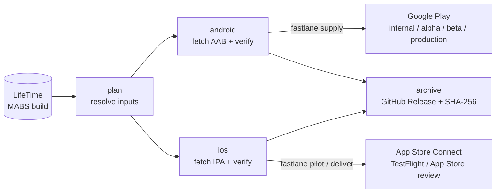

# OutSystems mobile store release pipeline

[](LICENSE)
[-red.svg)](#requirements)
[](Gemfile.lock)

**Publish your OutSystems 11 mobile app from LifeTime to Google Play and App Store Connect with one GitHub Actions form: no Mac, no store logins, no manual downloads.**

It takes the native build (AAB / IPA) that MABS already produced in an OutSystems **LifeTime** environment, checks that it is the right app and is signed correctly, uploads it with fastlane, and archives the binaries in GitHub Releases. The person releasing only needs write access to the repository. Each repository releases **one app** (the one in [`config/app.json`](config/app.json)); for several apps, use one repository per app.

## Features

- **Google Play**: `internal`, `alpha`, `beta` and `production` tracks, staged rollouts, drafts, release notes. A build that is already on Google Play is promoted from the track that holds it, or has its rollout raised.
- **App Store Connect**: TestFlight upload and App Store review submission (always with manual release). A build that is already in App Store Connect is not uploaded again.
- **Checks before anything is uploaded**: tagged LifeTime version, package / bundle ID, version strings, App Store distribution profile (not development, ad-hoc, enterprise or expired).
- **Dry run** that downloads and verifies both binaries and asks Google Play to validate the upload, without publishing.
- **Archive** of every released binary in GitHub Releases, with SHA-256.
- **Read-only credential check** workflow, offline tests, SHA-pinned actions, step-scoped secrets.

## Requirements

- **OutSystems 11** with **LifeTime** (LifeTime API v2), self-managed or OutSystems Cloud. **OutSystems Developer Cloud (ODC) is not supported.**
- Native builds generated by **MABS** for a **tagged** application version deployed to the source environment.
- A **Google Play** developer account where the app already exists and its **first AAB was uploaded by hand**.
- An **App Store Connect** app record that already exists (first version metadata filled in by hand).
- Three machine credentials, each created once ([docs/SETUP.md → Store credentials](docs/SETUP.md#6-store-credentials)):
  - a **LifeTime service account** token that can read the app and download its native builds;
  - a **Google Play service account** JSON key with release permissions on the app;
  - an **App Store Connect API key** (Team key, App Manager role).
- A **private** GitHub repository with Actions. The iOS job runs on a macOS runner: on private repositories, macOS minutes are billed at about 10 times the Linux rate.

Details and the full list: [docs/SETUP.md → Store prerequisites](docs/SETUP.md#store-prerequisites).

## Use this template

1. **Create your repository**: **Use this template → Create a new repository → Private** (or `gh repo create <name> --private --template <owner>/<repo>`). Don't fork it: a fork of a public repository is public, and the archive step would publish your binaries (it refuses to run in a public repository).
2. **Create a LifeTime service account token**, then **find your app's `lifetimeAppId`** with it ([docs/SETUP.md → First-time setup](docs/SETUP.md#first-time-setup)).
3. **Describe your app** in [`config/app.json`](config/app.json): `id`, `name`, `lifetimeAppId`, `androidPackage`, `iosBundleId`, the default LifeTime `environment` and the `platforms`. The template ships with placeholders, and `fetch` / `status` refuse to run until `lifetimeAppId` is replaced. Check with `python3 scripts/lifetime.py check-config`.
4. **Replace `.github/CODEOWNERS`**: it ships commented out with placeholders. Set your own user or team, or delete it.
5. **Create the store credentials**: a Google Play service account and an App Store Connect API key ([docs/SETUP.md](docs/SETUP.md#6-store-credentials)).
6. **Store them in GitHub** with `./scripts/setup-secrets.sh` (it also asks for your LifeTime host and the Google Play release-notes locales), and set up the `store-production` / `store-testing` environments ([docs/SETUP.md](docs/SETUP.md#4-github-environments-and-your-plan)).
7. **Run Check connections** (Actions → **Check connections**): read-only checks of LifeTime, Google Play and App Store Connect access.
8. **Do a dry run** of **Release to stores** before the first real release.

### Why not by hand?

| By hand | With this pipeline |
|---|---|
| Download the AAB / IPA from LifeTime | Fetched from LifeTime by the workflow |
| Check package ID, version and signing profile yourself | Checked automatically; a wrong build stops the run |
| Upload from a Mac (Transporter / Xcode) and Play Console, with personal logins | One form in GitHub Actions; no Mac, no personal store credentials |
| Keep the binaries somewhere, maybe | Every released binary archived with its SHA-256 |

> [!WARNING]
> **This pipeline publishes to production stores used by real customers.** Store submissions cannot be undone. When in doubt, run with `dry_run` first, and never run **Release to stores** "just to test".

## How it works



Android and iOS run in parallel and independently, so one platform failing doesn't stop the other. The archive step runs when at least one platform reached its store, and archives only the platforms that succeeded. Internals: [docs/ARCHITECTURE.md](docs/ARCHITECTURE.md).

## Release in 5 steps

1. **Prepare LifeTime.** Deploy a **tagged** version to the source environment (default: the `environment` in `config/app.json`) and wait for the native builds to finish. LifeTime only serves binaries of tagged versions.
2. **Do a dry run.** GitHub → **Actions** → **Release to stores** → **Run workflow**, choose your inputs and tick **`dry_run`**. Nothing is published or archived.
3. **Read the run summary.** For each platform it shows the environment, file, identifier, version / build and (iOS) signing profile. Confirm it is the build you expect.
4. **Run it for real.** Run the workflow again with the same inputs and `dry_run` unticked. Google Play `production` and App Store review run in the `store-production` environment, which asks for approval only if required reviewers are configured on it (this depends on your GitHub plan, see [docs/SETUP.md](docs/SETUP.md)). Without them, a production run goes out as soon as you start it (see [SECURITY.md](SECURITY.md#known-gaps)).
5. **Finish in the stores.** Check the build in Play Console / App Store Connect. App Store review submissions use **manual release**, so release the version in App Store Connect after Apple approves it. The binaries are archived in GitHub Releases ([docs/VERSION_ARCHIVING.md](docs/VERSION_ARCHIVING.md)).

Something failed? See [docs/TROUBLESHOOTING.md](docs/TROUBLESHOOTING.md). Every input, in detail: [docs/RELEASING_GUIDE.md](docs/RELEASING_GUIDE.md).

### Common releases

| I want to… | Set |
|---|---|
| Send a build to internal testers on both stores | defaults (`both`, `internal`, `testflight`) |
| Roll out to 20% of Android users | `platform=android`, `android_track=production`, `android_rollout=20` |
| Promote a build already on a Google Play track | `platform=android`, `android_track=<target track>` (when Google Play reports the version code as already uploaded, the pipeline promotes it from the track that holds it) |
| Raise the rollout of a staged release (e.g. 20% → 50%) | the same build, `android_track=production`, `android_rollout=50` (`100` completes the rollout) |
| Submit iOS for App Store review | `platform=ios`, `ios_target=app-store-review` |
| Prepare a Google Play release and finish it by hand | `android_release_status=draft` |

## Inputs

| Input | Default | Values |
|---|---|---|
| `platform` | `both` | `both`, `android`, `ios` |
| `environment` | `default` (= the `environment` in [`config/app.json`](config/app.json)) | `default`, or the exact name of a LifeTime environment (free text). Keep `default` for anything that reaches real users |
| `android_track` | `internal` | `internal`, `alpha`, `beta`, `production`. Only `production` uses `store-production`; `beta` (open testing) can be public |
| `android_rollout` | `100` | number `> 0` and `<= 100`; below `100` a `completed` release becomes a staged rollout. Ignored on `internal` and for `draft` releases |
| `android_release_status` | `completed` | `completed` (release now), `draft` (finish in Play Console) |
| `ios_target` | `testflight` | `testflight`, `app-store-review` |
| `release_notes` | empty | free text for both stores (Google Play keeps the first 500 characters). Google Play: in the `RELEASE_NOTES_LANGUAGES` locales; App Store: in the languages the App Store version already has |
| `archive_release` | `true` | create a GitHub Release with the binaries (refused in a public repository) |
| `dry_run` | `false` | verify without publishing: both binaries are still downloaded and verified; Android asks Google Play to validate the upload without committing it; iOS makes no App Store Connect call |

## What is checked before anything is uploaded

- The native build is configured in LifeTime and a binary is available.
- The running version is **tagged**. LifeTime returns HTTP 204 otherwise, and the run explains why.
- The package / bundle ID inside the binary equals `config/app.json`. If it can't be read, the run fails.
- iOS: the IPA is signed with an **App Store** distribution profile that hasn't expired. Enterprise, ad-hoc, development (including any profile with `get-task-allow`) and unsigned builds are rejected.
- The version and build read from the binary are plain version strings.
- Android: a warning if LifeTime served an APK instead of an AAB.

## Workflows

| Workflow | Trigger | Effect |
|---|---|---|
| [Release to stores](.github/workflows/release.yml) | manual | Publishes to the stores and archives the binaries |
| [Check connections](.github/workflows/check-credentials.yml) | manual | Read-only: LifeTime build status in every environment, Google Play and App Store Connect access (only for the platforms in `config/app.json`) |
| [Validate](.github/workflows/validate.yml) | pull request, push to `main` | Config check, unit tests, actionlint, Fastfile load and Fastfile decision tests |

## Documentation

| Document | Read it if you… |
|---|---|
| [docs/RELEASING_GUIDE.md](docs/RELEASING_GUIDE.md) | release the app: preparing LifeTime, every input, examples |
| [docs/TROUBLESHOOTING.md](docs/TROUBLESHOOTING.md) | have a failed run: error message → cause → fix |
| [docs/VERSION_ARCHIVING.md](docs/VERSION_ARCHIVING.md) | need a binary from a past release |
| [docs/SETUP.md](docs/SETUP.md) | set the pipeline up, or maintain it: credentials, secrets, variables, environments and approvals, key rotation |
| [docs/ARCHITECTURE.md](docs/ARCHITECTURE.md) | want to know how the pipeline works inside |
| [CONTRIBUTING.md](CONTRIBUTING.md) | want to contribute, or change the code or workflows |
| [CHANGELOG.md](CHANGELOG.md) | want to know what changed between versions |
| [SECURITY.md](SECURITY.md) | want to report a problem or understand how secrets are protected |
| [AGENTS.md](AGENTS.md) | are an AI coding assistant |

## Repository layout

```
config/app.json            The app: LifeTime application key, package / bundle IDs, default environment, platforms
scripts/lifetime.py        LifeTime client and binary inspection (plan, fetch, status, inspect, check-config)
scripts/setup-secrets.sh   Sets the Actions variables and secrets with gh
fastlane/Fastfile          Store lanes: android / ios upload and check_access
tests/test_lifetime.py     Unit tests (offline, LifeTime is mocked)
tests/test_fastfile.rb     Fastfile decision tests (offline, fastlane and Spaceship are stood in for)
.github/workflows/         release, check-credentials, validate
.github/dependabot.yml     Weekly updates for the pinned actions and gems
.github/CODEOWNERS         Placeholder owners: set your own or delete
Gemfile, Gemfile.lock      fastlane, locked with checksums
```

Local checks and how to change things safely: [CONTRIBUTING.md](CONTRIBUTING.md).

## Limitations and non-goals

- One app per repository.
- OutSystems 11 only (LifeTime API v2). ODC is not supported.
- LifeTime serves only builds of **tagged** versions: an untagged hotfix or a build generated from Service Center can't be fetched.
- It doesn't build or sign the app: MABS does.
- It doesn't manage store listings, screenshots or metadata beyond release notes.
- It doesn't add TestFlight tester groups or submit builds for beta review: a new build reaches the internal testers who get builds automatically, and external groups are managed in App Store Connect.
- App Store review submissions use manual release: you release the approved version in App Store Connect.

## Glossary

- **O11**: OutSystems 11, the platform this pipeline supports.
- **LifeTime**: the OutSystems 11 console that manages environments and deployments; its REST API serves the native builds.
- **MABS**: Mobile Apps Build Service, which produces the AAB / IPA for each environment.

## Licence

MIT, see [LICENSE](LICENSE).

## Disclaimer

Community project. Not affiliated with, endorsed by or supported by OutSystems, Google or Apple. OutSystems, LifeTime and MABS are trademarks of OutSystems. Use at your own risk: this pipeline publishes to production stores.
