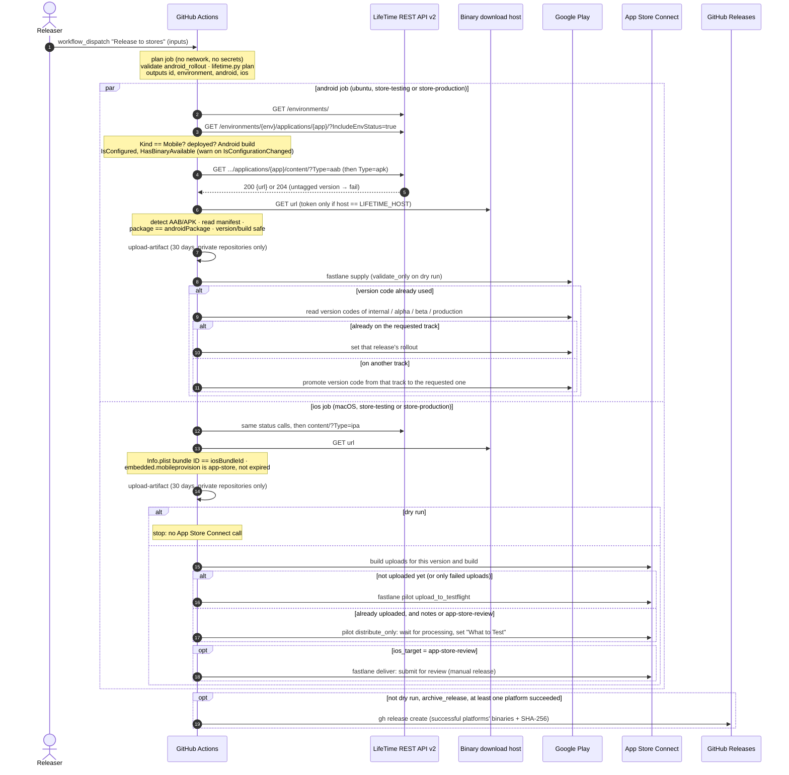
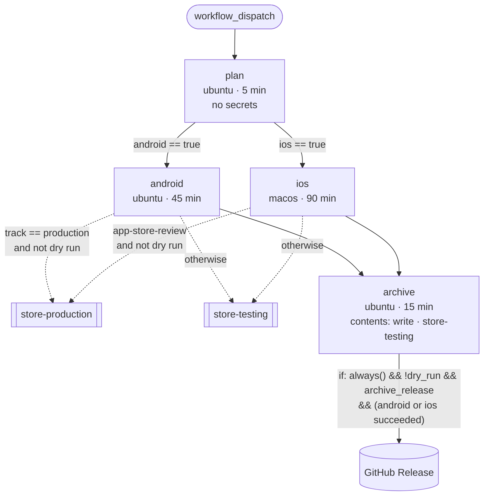

# Architecture

How the store release pipeline works, and why it is built this way. For using it, see the [README](../README.md) and [docs/RELEASING_GUIDE.md](RELEASING_GUIDE.md). For credentials and repository settings, see [docs/SETUP.md](SETUP.md). For failures, see [docs/TROUBLESHOOTING.md](TROUBLESHOOTING.md).

## Components

| Path | Role |
|---|---|
| [`config/app.json`](../config/app.json) | The one app this repository releases: `id`, `name`, LifeTime application key, `androidPackage`, `iosBundleId`, default LifeTime `environment`, `platforms` |
| [`scripts/lifetime.py`](../scripts/lifetime.py) | Standard-library Python CLI (`plan`, `fetch`, `status`, `inspect`, `check-config`): talks to the LifeTime REST API v2 and inspects the binaries |
| [`fastlane/Fastfile`](../fastlane/Fastfile) | Store uploads: `android upload` (supply), `ios upload` (pilot + deliver), and the read-only `check_access` lanes |
| [`.github/workflows/release.yml`](../.github/workflows/release.yml) | **Release to stores** (manual): `plan` → `android` ‖ `ios` → `archive` |
| [`.github/workflows/check-credentials.yml`](../.github/workflows/check-credentials.yml) | **Check connections** (manual, read-only) |
| [`.github/workflows/validate.yml`](../.github/workflows/validate.yml) | **Validate** (pull requests and pushes to `main`) |
| [`Gemfile`](../Gemfile) / `Gemfile.lock` | `fastlane ~> 2.225`, locked (currently 2.241.2) with SHA-256 checksums |
| [`tests/test_lifetime.py`](../tests/test_lifetime.py) | Offline unit tests for `lifetime.py` |
| [`tests/test_fastfile.rb`](../tests/test_fastfile.rb) | Offline decision tests for the Fastfile lanes |

## Release sequence

## Jobs and environments

- `android` and `ios` depend only on `plan`, so they run in parallel and one failing doesn't stop the other.
- `archive` depends on all three jobs and uses `always()`, so it still runs when one platform failed. Each binary is downloaded only if its job's result is `success`.
- Environments are chosen per job from the inputs. Today `alpha`, `beta`, TestFlight and every dry run use `store-testing`. `archive` runs in `store-testing` too (no secrets; its deployment-branch rules limit which branches create tags) and fails at once in a public repository. The security implications, and what the plan allows to be enforced, are in [docs/SETUP.md §4](SETUP.md#4-github-environments-and-your-plan).

## `lifetime.py`

### Commands

| Command | Network | Used by | Effect |
|---|---|---|---|
| `plan --platform --environment` | no | `release.yml` → `plan`; `check-credentials.yml` → `plan` | Loads and validates `config/app.json`. Intersects the requested platforms with the configured ones. Resolves `default` / empty to the configured environment. Writes `id`, `name`, `environment`, `android`, `ios`, `android_package`, `ios_bundle_id` |
| `fetch --platform --environment --out [--dry-run]` | LifeTime | `release.yml` → `android`, `ios` | Checks the build status, downloads, verifies and renames the binary. Writes `file`, `identifier`, `version`, `build`, `environment` and a step summary. `--dry-run` stops after obtaining the link (`file` empty). **The release workflow does not pass `--dry-run`**: a release dry run downloads and verifies the real binary |
| `status` | LifeTime | `check-credentials.yml` → `lifetime` | Table of app version and native build flags in every environment (an error in one environment becomes a row, not a failure) |
| `inspect <file>` | no | local use | Prints the metadata of a local `.aab` / `.apk` / `.ipa` |
| `check-config` | no | `validate.yml` | Validates `config/app.json`, emits `::error::` annotations |

There is deliberately no `--app` argument: the CLI only knows the app in `config/app.json` (a test asserts that `--app` is rejected).

### LifeTime API calls

Base URL: `https://<LIFETIME_HOST>/lifetimeapi/rest/v2`. Every request to the LifeTime host sends `Authorization: Bearer <LIFETIME_API_TOKEN>` (a binary download from another host doesn't; see token handling below); JSON calls send `Accept: application/json` and time out after 120 s.

| Call | Method in code | Purpose |
|---|---|---|
| `GET /environments/` | `environments()`, `environment_key()` | List environments. The requested environment matches by **exact** name or key, otherwise the error lists the available names |
| `GET /environments/{envKey}/applications/{appKey}/?IncludeEnvStatus=true` | `app_status()`, `mobile_status()` | Requires `Kind == "Mobile"`. Picks the `AppStatusInEnvs` entry for this environment, then the `MobileAppsStatus` entry whose `NativePlatform` is `Android` / `iOS` |
| `GET /environments/{envKey}/applications/{appKey}/content/?Type=<aab\|apk\|ipa>` | `download_link()` | Returns `{ "url": … }`. Android tries `aab`, then `apk`; iOS asks for `ipa` |
| `GET <url>` | `download()` | Streams the binary to disk in 1 MiB chunks, timeout 600 s |

Checks made from the status response before downloading:

- No status entry for the environment → "not deployed in this environment".
- No mobile entry for the platform → no build configured.
- `IsConfigured` false → fail (configure Native Platforms).
- `IsConfigurationChanged` true → **warning** only (the binary may be outdated).
- `HasBinaryAvailable` false → fail (generate the build first).

**HTTP 204 on `content/`.** LifeTime only serves binaries attached to a **tagged** version. When the running version isn't tagged (a hotfix, a build generated from Service Center), `content/` answers 204 with no body. `download_link()` treats 204 or an empty body as "no link". When every type returns nothing, `fetch` fails with an explanation that tells the user to deploy or tag a version in LifeTime.

**Case-insensitive JSON (`ci()`).** LifeTime responses don't use the casing of its own swagger consistently (e.g. `nativePlatform` vs `NativePlatform`). Every field is read with `ci(obj, key)`: an exact match first, then a case-insensitive one, and `None` for missing keys or non-dict values. Never index LifeTime JSON directly.

**Token handling.**

- **HTTPS only.** The host is normalised to `https://<host[:port]>`, lower case (a bare host, a URL with any scheme, a path and trailing slashes all work; anything that isn't a host name is refused). A download URL that isn't `https` is refused (`http://`, `file://`). A custom redirect handler (`_HttpsOnlyRedirects`) refuses any redirect to a non-HTTPS URL.
- **Not forwarded on redirect.** The token is attached with `add_unredirected_header`. `urllib` doesn't copy unredirected headers to the follow-up request when a redirect happens, so a redirect never carries the token, even to an HTTPS host.
- **Only to LifeTime.** A relative download URL (`/…`) is resolved against the LifeTime host. An absolute URL gets the token only if its host equals the LifeTime host (compared without regard to case). Storage / CDN hosts get an unauthenticated request.
- **Not in errors.** Errors include the HTTP status and the first 500 characters of the response body, never the request headers. Download errors include only the host.
- **Non-JSON answers.** A JSON call whose body isn't JSON (e.g. an SSO or proxy page) fails with the first 200 characters and a hint to check `LIFETIME_HOST` and `LIFETIME_API_TOKEN`.
- Connection errors, timeouts and connections dropped while reading a response become a `PipelineError`, not a traceback. For JSON calls the message suggests an IP allowlist as a likely cause (GitHub-hosted runners have changing IPs).

### Binary verification in `fetch`

1. The download goes to `<id>-<platform>.download` and must be a valid ZIP.
2. **Type detection**: iOS is always `ipa`. Android is `aab` if the archive contains `base/manifest/AndroidManifest.xml`, otherwise `apk` (with a warning, since Google Play needs an App Bundle for new apps). The API can serve an APK when an AAB was asked for, so the file decides, not the request.
3. **Identifier**: must be readable and equal `androidPackage` / `iosBundleId`. An unreadable identifier is a failure, not a skip. A file that isn't a valid archive of its type (missing manifest, broken `Info.plist`) fails with "is not a valid .<ext> file".
4. **iOS signing**: the profile type must be `app-store`, and the profile's `ExpirationDate` must not have passed (App Store Connect would reject the upload).
5. **Version / build**: `version` is the binary's `versionName` / `CFBundleShortVersionString` (falling back to LifeTime's `VersionNumber`, which can lag behind). `build` is `versionCode` / `CFBundleVersion`. Both must match `^[0-9A-Za-z][0-9A-Za-z._-]{0,63}$`, because they end up in `GITHUB_OUTPUT`, file names and release tags.
6. The file is renamed `<id>-<version>-<build>.<ext>`, e.g. `my-app-3.2.1-30201.aab`.

### Binary inspection internals

**AAB (`inspect_aab`).** In an App Bundle, `base/manifest/AndroidManifest.xml` is an aapt2 **protobuf** `XmlNode`, not text or binary XML. `lifetime.py` contains a minimal protobuf reader, with no dependency:

- `_varint` / `_proto_fields` decode varints and wire types 0, 1, 2 and 5. Unknown wire types, field 0 or a length overrunning the buffer raise `ValueError`.
- `proto_manifest_attributes` walks every length-delimited field recursively, to a depth of 12, treating each one as a possible sub-message (malformed ones are silently skipped). A message with a string field 2 (`XmlAttribute.name`) in the wanted set and a field 3 (`value`) is recorded. The first occurrence wins.
- It collects `package`, `versionCode` and `versionName`.

**APK (`inspect_apk`).** An APK manifest is binary XML, which isn't parsed in Python. The script runs `aapt2 dump badging`, found on `PATH` or in the newest `$ANDROID_HOME` / `$ANDROID_SDK_ROOT` `build-tools/*/aapt2`, and reads `package: name=… versionCode=… versionName=…`. Without `aapt2` all fields are `None`, so `fetch` fails on the unreadable identifier.

**IPA (`inspect_ipa`).**

- Finds the first `Payload/<name>.app/` directory (none → "not a valid IPA").
- Reads `Info.plist` (binary or XML): `CFBundleIdentifier`, `CFBundleShortVersionString`, `CFBundleVersion`.
- Reads `embedded.mobileprovision`. It's a CMS-signed envelope, so the code takes the bytes from `<?xml` to `</plist>` and parses that plist (the signature isn't verified; the App Store does that). It reports the profile `Name`, first `TeamIdentifier`, `ExpirationDate` (`profileExpires`) and whether it has passed (`profileExpired`, compared in UTC).
- Profile type, in this order:

| Condition | Type |
|---|---|
| no `embedded.mobileprovision` | `unsigned` |
| `ProvisionsAllDevices` true | `enterprise` |
| `Entitlements.get-task-allow` true (with or without devices) | `development` |
| `ProvisionedDevices` non-empty | `ad-hoc` |
| anything else | `app-store` |

### Outputs

`set_outputs` appends `key=value` lines to `$GITHUB_OUTPUT` and **refuses any value containing a newline**, so a value read from LifeTime or a binary can't inject extra outputs. Without `GITHUB_OUTPUT` (local runs) it only prints. Errors and warnings become `::error::` / `::warning::` annotations when `GITHUB_ACTIONS` is set; `%`, carriage returns and newlines in the message are escaped, so text from a server response or a binary stays one annotation and can't start another workflow command.

## Fastfile

### Env contract

The environment variables each lane reads, with their defaults, are the contract in [AGENTS.md → Fastfile environment](../AGENTS.md#fastfile-environment). Implementation notes:

- `RELEASE_FILE` must exist. `android upload` passes a `.aab` as `aab` and anything else as `apk`.
- `ANDROID_ROLLOUT` must be `> 0` and `<= 100`, `ANDROID_RELEASE_STATUS` must be `completed` or `draft`, and `IOS_TARGET` must be `testflight` or `app-store-review`; otherwise the lane fails before calling the store.
- The App Store Connect key is built in memory (`key_content`, not base64, `in_house: false`), never written to disk by the lane.
- `android check_access` calls `google_play_track_version_codes` on `production`; `ios check_access` creates the API key (which sets the shared Spaceship token) and calls `Spaceship::ConnectAPI::App.find` by bundle ID. Both are read-only.
- `DRY_RUN` is true for `true`, `1`, `yes` or `y` (any case). Empty or whitespace-only `RELEASE_NOTES` count as no notes.

### Android: `upload`

- Metadata, images, screenshots and (by default) changelogs are skipped. Only the binary and, optionally, release notes are uploaded.
- **Staged rollout**: when `status == completed` and `0 < rollout < 100`, the release status becomes `inProgress` with `rollout = rollout / 100`. A `draft` release ignores the rollout (it is chosen when the draft is published in Play Console), and so does the `internal` track, which has no staged rollouts (all internal testers get the build).
- **Release notes**: written to `build/play-metadata/<locale>/changelogs/default.txt` for each locale in `RELEASE_NOTES_LANGUAGES`, truncated to Google Play's 500 characters (with a warning). `supply` reads them from there.
- **Dry run**: the same call with `validate_only: true`. Google Play validates the edit (upload, version code, track) and doesn't commit it. The version-code lookups below are read-only, and a promotion or rollout change on a dry run is validated the same way.
- **Version-code reuse.** Google Play rejects a second upload of the same version code (`already been used` / `apkUpgradeVersionConflict`). The lane then reads (read-only, `google_play_track_version_codes`) which of `internal`, `alpha`, `beta`, `production` currently holds that version code:
  - **Already on the requested track**: the lane changes that release's rollout (`upload_to_play_store` with `track`, `version_code` and `rollout`; e.g. 20% → 50%, while `100` completes a staged rollout), updating the release notes if given. If the release there is already fully released, it fails with "already fully released… generate a build with a higher version code". A `draft` request on the same track fails.
  - **On another track**: it retries as a **promotion**: `track: <first track holding it, in the order internal, alpha, beta, production>`, `track_promote_to: <track>`, `version_code`, with the requested status, rollout and release notes. This works for any target, `internal` included.
  - **On no track** (superseded, or only in App bundle explorer): it fails with instructions to add it in Play Console (**Create release → Add from library**) or to generate a build with a higher version code.
  - Like Play Console, a promotion or rollout change replaces the release on the target track: a newer release supersedes an older in-progress staged rollout there.
  - Any other upload error, or a duplicate without `ANDROID_VERSION_CODE`, is re-raised.

### iOS: `upload`

1. **Dry run** returns before any App Store Connect call (the API key isn't even created). The IPA was already verified by `fetch`.
2. **Duplicate check**: the lane finds the app by bundle ID (fails if the key can't see it) and asks the App Store Connect `buildUploads` API for exactly `IOS_VERSION` + `IOS_BUILD`, filtered server side on state `PROCESSING,COMPLETE` (as fastlane's own `app_store_build_number` does; in responses the state is an object). A match means the build is already there, so it isn't uploaded again (a re-run, or submitting a build already on TestFlight, works). An earlier `FAILED` upload doesn't count, and if the lookup itself fails the lane logs it and uploads.
   - When it is already there and there are release notes or the target is `app-store-review`, the lane calls `upload_to_testflight` with `distribute_only: true` and `skip_submission: true`: it waits for processing and, with notes, sets "What to Test". Tester groups are not changed.
3. **Upload** (`upload_to_testflight`, only when not already uploaded): with `changelog` = release notes, `distribute_external: false` (no external tester groups), `uses_non_exempt_encryption` from `IOS_USES_NON_EXEMPT_ENCRYPTION` (default `false`; only used when `Info.plist` doesn't declare `ITSAppUsesNonExemptEncryption`). It waits for build processing unless the target is TestFlight **and** there are no release notes: submission and setting "What to Test" both need a processed build.
4. **Submission** (`ios_target=app-store-review`): `deliver` with `skip_binary_upload`, `skip_screenshots`, `skip_metadata: false` (deliver only applies `automatic_release` while it updates the version's metadata, so that step always runs; without notes the release type is all it changes), release notes if there are any (the same text for exactly the languages the App Store version already has: the version being prepared, else the live version, else the app's primary language; never adding a language, which would create an empty localization), `submit_for_review: true`, **`automatic_release: false`** (someone releases the approved version by hand in App Store Connect), `force: true` (no interactive preview), `run_precheck_before_submit: false`, and `submission_information` with `add_id_info_uses_idfa: false` and `export_compliance_uses_encryption` from `IOS_USES_NON_EXEMPT_ENCRYPTION`.

## Workflow design decisions

| Decision | Where | Why |
|---|---|---|
| **One app, pinned identity** | `config/app.json`, no app input | The pipeline can't be pointed at another app or LifeTime key. A binary with an unexpected or unreadable identifier is refused before any store call |
| **Inputs as choices** | `release.yml` inputs | Tracks and targets are fixed lists. Only `environment` (a LifeTime environment name, checked against LifeTime's own list), `android_rollout` and `release_notes` are free text, and they reach the scripts only through `env:`. `android_rollout` is checked in `plan` (number, `> 0`, `<= 100`) |
| **No expression interpolation in scripts** | every `run:` | Inputs and outputs reach shell steps through `env` and are quoted (`"$ENVIRONMENT"`), so free text like `release_notes` can't inject commands. `run-name` interpolates inputs, which is only a display string |
| **Least privilege for `GITHUB_TOKEN`** | `permissions: contents: read` at workflow level | Only `archive` gets `contents: write`, to create the release. It runs in `store-testing` and refuses to run in a public repository, where it would publish the binaries |
| **Secrets per step** | step `env` | Each key is visible only to the one step that uses it |
| **SHA pinning** | every `uses:` | Actions are pinned to a full commit SHA with a `# vX.Y.Z` comment. A moved tag can't change the code that runs next to the store keys |
| **`persist-credentials: false`** | every `actions/checkout` | The `GITHUB_TOKEN` isn't left in `.git/config`, where later steps (fastlane and its gems) could read it. Nothing in these workflows pushes |
| **`BUNDLE_FROZEN=true` + lockfile checksums** | workflow `env`, `Gemfile.lock` `CHECKSUMS` | `bundle install` installs exactly the locked gems and fails instead of re-resolving. Jobs that hold store keys run it themselves, without restoring the gem cache; only **Validate** (no secrets) uses `ruby/setup-ruby` with `bundler-cache: true`. Dependabot (`.github/dependabot.yml`, weekly, 7-day cooldown) proposes updates. Bundler checks each downloaded gem against its SHA-256. After a `Gemfile` change, run `bundle lock --add-checksums` |
| **Standard-library Python** | `lifetime.py` | No `pip install` on the runner: no third-party Python code next to the LifeTime token |
| **Concurrency** | `concurrency: release-to-stores`, `cancel-in-progress: false`; Validate: `validate-<ref>`, `cancel-in-progress: true` | At most one release runs at a time, and a running release is never cancelled by a new dispatch. GitHub keeps only **one pending** run per group: if a third run is dispatched while one runs and one waits, the waiting one is cancelled and replaced. Don't queue several releases and expect them all to run. Validate cancels an older run on the same ref |
| **Timeouts** | `timeout-minutes` | `plan` 5, `android` 45, `ios` 90, `archive` 15. Check connections: `plan` 5, `lifetime` 10, `android` 15, `ios` 15. Validate 15. A hung upload or LifeTime call can't hold the concurrency slot for GitHub's default 6 hours |
| **iOS on macOS, checks on Linux** | `runs-on` | The release `ios` job runs on `macos-latest`. The `ios check_access` lane only calls the App Store Connect API and runs on `ubuntu-latest` |
| **Workflow artifacts** | `upload-artifact`, 30 days, `if: github.event.repository.private` | The verified binary is passed to `archive` and stays downloadable from the run for 30 days, dry runs included. Skipped in a public repository, where any signed-in GitHub user could download it (`archive` refuses to run there anyway) |
| **Archive only successful platforms** | `archive` job | `if: always() && !inputs.dry_run && inputs.archive_release && (android or ios succeeded)`. Each binary download step checks its own job result, so a release never archives a binary that didn't reach its store |
| **Release naming** | `archive` script | Tag `<id>-v<version>-<UTC yyyymmddHHMM>` (version from Android if it succeeded, else from iOS if it succeeded, else `unknown`), title `<id> v<version>`, target `$GITHUB_SHA`, `--latest=false`. The body lists the version / build per platform, the release notes and the `sha256sum` of each file. See [docs/VERSION_ARCHIVING.md](VERSION_ARCHIVING.md) |

## Check connections and Validate

- **Check connections**: a `plan` job (no network, no secrets) reads the platforms and identifiers from `config/app.json` with `lifetime.py plan`, then three independent read-only jobs run: LifeTime `status`, `android check_access` and `ios check_access`, described in [docs/SETUP.md §3](SETUP.md#3-verify-without-publishing). A store job is skipped when its platform isn't in `platforms`, so the workflow also passes for an Android-only or iOS-only app. The jobs use repository-level secrets and declare no environment.
- **Validate** runs on every pull request and on pushes to `main`, without secrets: `lifetime.py check-config`, the unit tests, `actionlint` on the workflows, `bundle exec fastlane lanes` (proves the Fastfile parses and the locked gems install) and `ruby tests/test_fastfile.rb`.

## Testing strategy

The Python tests are in [`tests/test_lifetime.py`](../tests/test_lifetime.py) (41 tests), use only `unittest`, and **never touch the network**. Run them with `python3 -m unittest discover -s tests -v`. The Fastfile tests are in [`tests/test_fastfile.rb`](../tests/test_fastfile.rb) (see below).

| Class | Covers |
|---|---|
| `InspectTests` | A synthetic AAB with a hand-built aapt2 proto manifest (namespace declaration, attributes with and without a namespace) parses to the right package / versionName / versionCode. An IPA with a binary `Info.plist` and a mobileprovision wrapped in fake CMS bytes reports identifier, versions, `app-store` and the team ID. Every profile-type rule: ad-hoc, development (also `get-task-allow` without devices), enterprise, unsigned. Profile expiry. A broken `Info.plist`, a malformed provisioning profile or an AAB without a manifest is a `PipelineError` |
| `ConfigTests` | The committed `config/app.json` is valid (whatever app it describes). A broken config reports each bad field, values of the wrong type included, and a missing or non-JSON file is a `PipelineError`. iOS bundle IDs may contain hyphens, Android packages may not, and an identifier is only required for a listed platform. Annotations are escaped to one line. `plan` outputs for iOS-only and for an environment override. `--app` is rejected. Multi-line output values are refused |
| `LifeTimeClientTests` | Host normalisation (also a host name starting with `http`, and values that aren't a host) and `ci()`. The token goes to LifeTime as an **unredirected** header (and isn't in the normal headers that a redirect would copy), and isn't sent to a CDN host at all. Non-HTTPS download URLs are refused. Timeouts and dropped connections are a `PipelineError`. A redirect to `http://` is refused. `get()` parses JSON, handles an empty 204, turns a non-JSON body and an HTTP error into `PipelineError`. Lower-case LifeTime keys still resolve |
| `FetchTests` | Full `fetch` against a `FakeLifeTime`: Android success and file naming. Identifier mismatch. Unreadable identifier (APK without `aapt2`). No binary available. No link (the 204 case). iOS enterprise, development and expired profiles refused, app-store accepted. APK served instead of AAB. A download that isn't an archive. An unsafe version string. The template placeholder `lifetimeAppId` stops `fetch` and `status` before LifeTime is called. `--dry-run` doesn't download. `status` prints a row per environment (deployed, not deployed, error) |
| `test_fastfile.rb` (`ruby tests/test_fastfile.rb`) | Evaluates the real Fastfile against stand-ins for the fastlane actions and Spaceship it uses (no gems, no network) and checks every store call: staged / full / draft / internal rollouts, release notes per locale and the 500-character limit, `validate_only` on dry run, rollout and release-status validation, promotion from whichever track holds the version code, rollout change on the same track, already fully released, version code on no track, errors re-raised. iOS: dry run makes no call, new upload, existing upload skipped (and the server-side state filter sent), failed upload retried, "What to Test" on an existing build, lookup failure, export-compliance answer, App Store review with notes in the version's own languages (and the live-version / primary-language fallbacks), manual release set with and without notes, an invalid `IOS_TARGET`, unknown app, both `check_access` lanes. The Spaceship stand-ins have the same signatures as fastlane 2.241.2 (e.g. `App.find` takes no `client:`), and upload states are objects as in the real API. 31 runs |

Not covered by unit tests, and how it is checked instead:

- **fastlane itself**: `test_fastfile.rb` replaces the fastlane actions, so it checks the parameters the lanes send, not how fastlane or the stores react. That is checked by `dry_run` releases and **Check connections**; the behaviour relied on was read from the locked fastlane source (2.241.2).
- **Workflows**: linted by `actionlint`. Environment selection and the `archive` conditions aren't executed in tests.
- **Real LifeTime responses**: the client is mocked. `ci()` and the explicit 204 handling are there because the real API varies.
- **`aapt2` success path** for APKs, and parsing of real (not synthetic) AAB / IPA files.

When you change `lifetime.py`, add a test in the matching class and keep it offline: patch `lifetime_client` or `_opener.open`, never call a real host.
