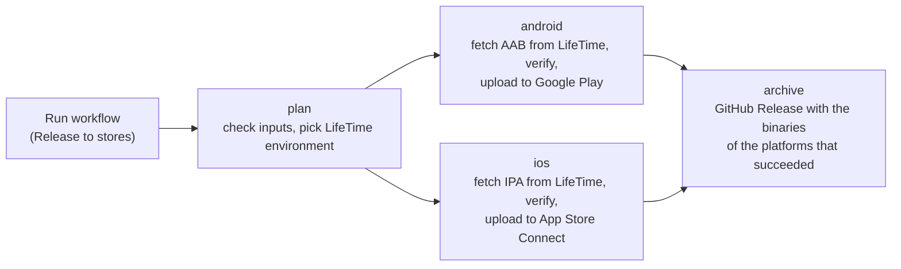
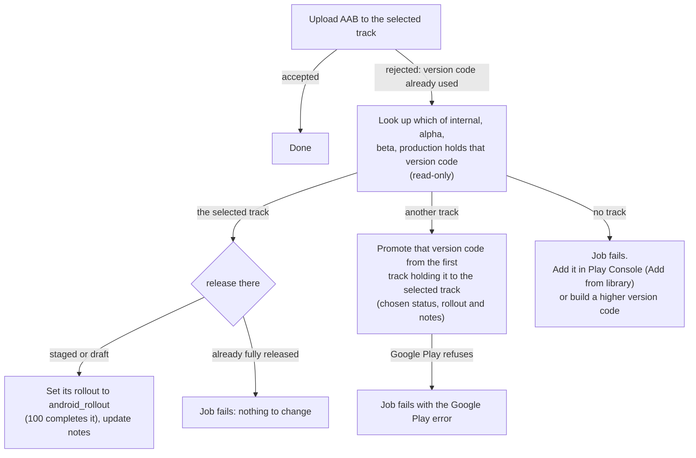
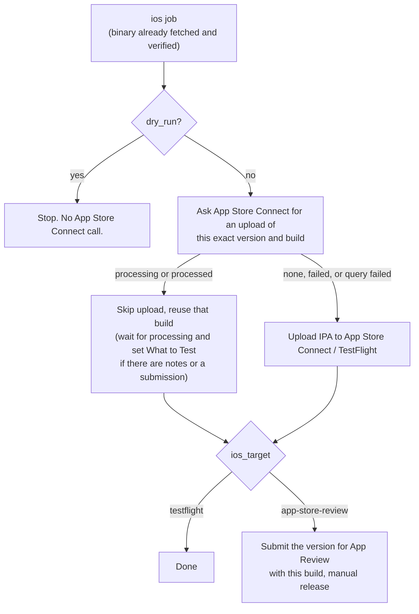

# Releasing your app

Runbook for OutSystems mobile developers who publish their app (the one in `config/app.json`) to Google Play and App Store Connect. You don't need to know GitHub Actions or fastlane: you pick options in a form, and this page tells you what each option does.

- Something failed? Go to [TROUBLESHOOTING.md](TROUBLESHOOTING.md).
- Where the binaries are kept afterwards: [VERSION_ARCHIVING.md](VERSION_ARCHIVING.md).
- Credentials, GitHub environments, approvals setup (maintainers): [SETUP.md](SETUP.md).
- How the pieces fit together: [ARCHITECTURE.md](ARCHITECTURE.md).

> [!CAUTION]
> The **Release to stores** workflow publishes the real app. Unless `dry_run` is ticked, a run uploads to Google Play and/or App Store Connect and can reach real users. When in doubt, do a dry run first.

## Contents

1. [How a release runs](#1-how-a-release-runs)
2. [Pre-flight checklist](#2-pre-flight-checklist)
3. [Start a release](#3-start-a-release)
4. [Workflow inputs](#4-workflow-inputs)
5. [Recipes](#5-recipes)
6. [Approvals (`store-production`)](#6-approvals-store-production)
7. [Reading the run](#7-reading-the-run)
8. [Post-release checks](#8-post-release-checks)

## 1. How a release runs

The workflow only releases the app in `config/app.json`: there is no "app" input. It never builds the app. It takes the native build that MABS already generated in LifeTime, checks it, and sends it to the stores.



| Job | Runs on | What it does |
|---|---|---|
| `plan` | Linux, 5 min max | Checks `android_rollout` and `config/app.json`, decides which platforms run and which LifeTime environment to use. No network calls. |
| `android` | Linux, 45 min max | Downloads the Android binary from LifeTime, checks it is a valid archive with package `com.example.myapp`, uploads it with fastlane to Google Play. |
| `ios` | macOS, 90 min max | Downloads the IPA from LifeTime, checks bundle ID `com.example.myapp` and that it is signed with an **App Store** profile, uploads with fastlane to App Store Connect (TestFlight), optionally submits for review. |
| `archive` | Linux, 15 min max | Creates a GitHub Release with the binaries and their SHA-256. Skipped on dry runs or when `archive_release` is off. |

Things worth knowing:

- **Android and iOS are independent.** They run in parallel; one failing doesn't stop or undo the other. The archive job still runs if at least one of them succeeded and archives only the platforms that succeeded.
- **Both binaries are verified before upload.** If the identifier doesn't match, or the IPA isn't App Store–signed, the job stops before contacting the store.
- **One release at a time.** Runs share one concurrency group and never run in parallel. GitHub keeps only *one* waiting run: if a release is running and you dispatch two more, the first of the two waiting runs is cancelled and replaced by the newest.
- In a private repository, each binary is also kept as a workflow artifact on the run for 30 days (also on dry runs). In a public repository no artifact is created, because anyone signed in to GitHub could download it.

## 2. Pre-flight checklist

Go through this before every release that isn't a dry run.

**In LifeTime** (Applications → <your app>)

- [ ] The version you want is **tagged** (e.g. `3.2.1`) and **deployed through LifeTime** to the source environment, normally the one in `config/app.json`. The LifeTime API only serves native binaries attached to a tagged version. A hotfix or a build generated from Service Center is not served (see [HTTP 204](TROUBLESHOOTING.md#lifetime-fetch)).
- [ ] The **native builds have finished** for that environment, for every platform you will release. The pipeline does not trigger or wait for MABS builds.
- [ ] **Native Platforms** for that environment:
  - Android: build type **Release**, format **AAB**.
  - iOS: build type **App Store** with a valid, **unexpired** App Store distribution profile (the pipeline refuses an expired one).
- [ ] If you changed the native configuration (Native Platforms, plugins, signing) after the last build, regenerate the build. The pipeline only *warns* about this (`native configuration changed since the last build`).

**In the stores**

- [ ] Android: the version code of the new build is **higher** than anything already in Google Play, unless you are deliberately [promoting a build already on Google Play](#promote-a-build-already-on-google-play) or changing the rollout of one.
- [ ] iOS, when submitting for review: the app version is **not already submitted or in review** in App Store Connect. Apple only allows one version in review at a time (store rule, not checked by the pipeline).

**In GitHub**

- [ ] Unsure whether credentials or LifeTime still work? Run **Actions → Check connections → Run workflow**. It is read-only: it shows the build status in every LifeTime environment and checks Google Play and App Store Connect access. Nothing is uploaded.
- [ ] Do a **dry run** with the same inputs you plan to use. It downloads and verifies the real binaries and, for Android, asks Google Play to validate the release. See [`dry_run`](#dry_run) for what it does *not* check on iOS.
- [ ] For a production run: if required reviewers are configured on `store-production`, make sure a [reviewer](#6-approvals-store-production) is available to approve it. If they aren't, nothing stops the run once you start it.

## 3. Start a release

### From the GitHub UI

1. Open the repository → **Actions** → **Release to stores** (left sidebar).
2. Click **Run workflow** (top right of the run list).
3. Leave **Use workflow from** on `main` unless a maintainer told you otherwise. The workflow definition and fastlane code of that branch are what runs.
4. Fill in the inputs (see [section 4](#4-workflow-inputs)). The defaults are a safe test release: both platforms, Google Play **internal** track, **TestFlight**.
5. Click **Run workflow**. The run appears in the list after a few seconds, named like:
   `Release → both (android:internal ios:testflight) [dry run] by @you`
6. Open the run to follow it. If required reviewers are configured, production jobs show as waiting, with a **Review deployments** button, until a reviewer approves (see [section 6](#6-approvals-store-production)).

### From the terminal (`gh` CLI)

Requires the [GitHub CLI](https://cli.github.com/) logged in (`gh auth login`) with write access to the repository. Run the commands from a clone of the repository, or add `-R <owner>/<repo>`.

```bash
# Start a run. Every -f is optional; omitted inputs take their default.
gh workflow run release.yml --ref main -f dry_run=true

# Find the run you just started and follow it live
gh run list --workflow release.yml --limit 5
gh run watch <run-id>

# Open it in the browser (summary, annotations, approval button)
gh run view <run-id> --web

# Show only the logs of the failed steps
gh run view <run-id> --log-failed
```

Booleans are passed as `true` / `false`; choice inputs must match one of the allowed values exactly; `environment` is free text and must match a LifeTime environment name exactly, including spaces and case (e.g. `-f environment="Staging"`).

## 4. Workflow inputs

| Input | Default | Allowed values |
|---|---|---|
| [`platform`](#platform) | `both` | `both`, `android`, `ios` |
| [`environment`](#environment) | `default` (= the `environment` in `config/app.json`) | `default`, or the exact name of a LifeTime environment (free text) |
| [`android_track`](#android_track) | `internal` | `internal`, `alpha`, `beta`, `production` |
| [`android_rollout`](#android_rollout) | `100` | a number `> 0` and `<= 100` (decimals allowed, e.g. `2.5`) |
| [`android_release_status`](#android_release_status) | `completed` | `completed`, `draft` |
| [`ios_target`](#ios_target) | `testflight` | `testflight`, `app-store-review` |
| [`release_notes`](#release_notes) | empty | free text |
| [`archive_release`](#archive_release) | `true` | `true`, `false` |
| [`dry_run`](#dry_run) | `false` | `true`, `false` |

Android inputs are ignored when only iOS runs, and vice versa, with one exception: `android_rollout` is always validated, so an invalid value fails the `plan` job even for `platform=ios`.

### `platform`

Which jobs run. `both` runs Android and iOS in parallel; `android` or `ios` runs only that one (the other job shows as skipped).

### `environment`

The LifeTime environment the binary is downloaded from. `default` means the environment in `config/app.json` (`Production` in the template). Any other value must be the exact name of one of your LifeTime environments.

The pipeline does **not** stop you from sending a build from a test environment to a production track. Builds from other environments usually point at other backends. It will stop if that environment's build has a different package / bundle ID, or (iOS) isn't App Store–signed, but not otherwise. For anything going to real users, use `default`.

### `android_track`

The Google Play track the release goes to.

| Value | Who gets it | Approval |
|---|---|---|
| `internal` | Internal testers on the Play Console tester list | No |
| `alpha` | Closed testing track | No |
| `beta` | Open testing track (open testing can be joined by the public) | No |
| `production` | Real users | Runs in `store-production` (not on dry runs): approval only if required reviewers are configured |

Who exactly receives a testing track depends on its tester lists in Play Console; the pipeline doesn't change them.

**When the version code is already in Google Play.** If Google Play rejects the upload because the version code was already used (the error contains `already been used` or `apkUpgradeVersionConflict`):



- The source of a promotion is the first track holding the build, in the order internal, alpha, beta, production. This works for any selected track, `internal` included.
- A `draft` request on a track that already holds the build fails: manage it in Play Console.
- Like a release made in Play Console, the promoted or updated release replaces the current release on that track; an older staged rollout there is superseded.
- Any other Google Play error fails the job unchanged.

### `android_rollout`

Percentage of users for a staged rollout. Validated in `plan` (and again by fastlane): a plain number greater than `0` and at most `100`.

| `android_release_status` | `android_rollout` | What Google Play receives |
|---|---|---|
| `completed` | `100` | Release with status `completed` (full rollout) |
| `completed` | below `100`, e.g. `10` | Release with status `inProgress` and user fraction `0.1` (staged rollout) |
| `draft` | anything | Release with status `draft`; the rollout value is **ignored** (choose it when publishing the draft in Play Console) |

On the `internal` track the value is **ignored** too: internal testing has no staged rollouts, so a `completed` release goes to all internal testers (the log warns). The same rules apply when the build is [promoted](#android_track). Staged rollouts are normally used on `production`, and Google Play decides whether the chosen track accepts one.

**Changing the rollout of an existing release.** Run the pipeline again with the **same build** on the same track and the new percentage: Google Play rejects the repeated version code and the pipeline sets the rollout of that release instead (`100` completes it). Halting a rollout is done in Play Console. See [the rollout recipe](#production-staged-rollout-and-increasing-it).

### `android_release_status`

- `completed`: send the release now. On `production` this normally goes to Google review and then to users. If **Managed publishing** is on in Play Console, Google waits for someone to click **Publish** after review (Play Console setting, not controlled by the pipeline).
- `draft`: create a draft release on the track. Nothing reaches users until someone opens it in Play Console and rolls it out. Use this when you want a person to do the last click in Play Console.

The run summary says **Uploaded** for both, so check Play Console to see whether a release is a draft or live.

### `ios_target`



**`testflight`** (no approval)

- Uploads the IPA to App Store Connect, where it appears in TestFlight once Apple finishes processing.
- The pipeline does **not** distribute to external tester groups. Internal testers see the build according to your TestFlight settings in App Store Connect.
- Without release notes the job finishes as soon as the upload is accepted, without waiting for Apple's processing. With release notes it waits for processing so it can set **What to Test**.

**`app-store-review`** (runs in `store-production`, except on dry runs: approval only if required reviewers are configured)

- Uploads the IPA (unless that build is already there, see below) and **waits for Apple's processing**.
- Selects that build for the app version read from the IPA (`CFBundleShortVersionString`) and **submits it for App Review**, with:
  - **manual release** (`automatic_release: false`, set on every submission, with or without release notes): after Apple approves, the version waits in App Store Connect until someone clicks **Release this version**;
  - **What's New** set from `release_notes` (if given) in exactly the languages the App Store version already has (the version being prepared, else the live version, else the app's primary language). No language is added;
  - no screenshots and no other metadata: release notes are the only listing text the pipeline sends;
  - the advertising-identifier (IDFA) answer set to "no";
  - the export-compliance answer from the `IOS_USES_NON_EXEMPT_ENCRYPTION` variable (default `false`), used only if the build's `Info.plist` doesn't declare `ITSAppUsesNonExemptEncryption`. The same answer is recorded on new TestFlight uploads. Prefer declaring the key in `Info.plist` through MABS extensibility; set the variable to `true` if your app uses non-exempt encryption.
- Apple usually requires **What's New** for an update; if you leave `release_notes` empty and the version has none, the submission can be rejected by App Store Connect.

**Build already in App Store Connect.** Before uploading, the job asks App Store Connect whether this exact version and build number was already uploaded (build uploads in state `PROCESSING` or `COMPLETE`). If so, the upload is skipped and the existing build is used (log: `Build <n> of version <v> is already in App Store Connect. Not uploading it again.`). With `release_notes`, or for `app-store-review`, the job then waits for Apple's processing and sets the notes as **What to Test** on that build, without changing tester groups. This makes re-runs safe, and lets you submit for review a build you already tested on TestFlight. An earlier upload that failed doesn't count, so that build is uploaded again; if the check itself fails, the job uploads and App Store Connect decides.

### `release_notes`

Optional. One text, used for both stores. The UI field is a single line.

| Destination | Where the text goes |
|---|---|
| Google Play (any track) | Release notes ("What's new") for every locale in `RELEASE_NOTES_LANGUAGES`. Google Play keeps **500 characters**: longer text is cut to the first 500 and the log warns `Release notes are <n> characters; Google Play keeps only the first 500.` |
| TestFlight | **What to Test** of the build (the uploaded one, or the one already in App Store Connect) |
| App Store review | **What's New** of the version, in the languages the App Store version already has (`RELEASE_NOTES_LANGUAGES` is not used) |
| GitHub Release | "What's New" section of the [archive](VERSION_ARCHIVING.md) |

`RELEASE_NOTES_LANGUAGES` is a repository variable set by maintainers (comma-separated, default `en-US`). It applies to **Google Play only**, and each locale must be a language of your Google Play store listing. App Store "What's New" goes to the languages the App Store version already has. The same text is used everywhere; the pipeline does not translate.

If `release_notes` is empty, the pipeline sends no release notes to Google Play and leaves App Store metadata as it is.

### `archive_release`

When `true` (default), the `archive` job creates a GitHub Release with the binaries of the platforms whose upload succeeded and their SHA-256. Never runs on dry runs. It runs in the `store-testing` environment and refuses to run in a public repository, where it would publish the binaries. Details: [VERSION_ARCHIVING.md](VERSION_ARCHIVING.md).

### `dry_run`

Validates as much as possible without publishing. On both platforms it runs the real `plan` and fetch steps: downloads the binary from LifeTime and verifies identifier, version and (iOS) signing. Then:

| | Android | iOS |
|---|---|---|
| Store call | fastlane prepares the release in a Google Play edit (the bundle is sent to Google) and passes `validate_only`, so Google Play validates the edit instead of committing it | **None.** The fastlane step skips the upload and submission; App Store Connect is never contacted |
| What it proves | The binary is right and Google Play would accept this release (upload, version code, track; a promotion or rollout change is validated the same way). Nothing is committed | The binary is right. Nothing about App Store Connect credentials, build numbers or review (the API key isn't even loaded) |
| GitHub environment | `store-testing`, so no approval | `store-testing`, so no approval |
| Archive | No | No |

To check App Store Connect access without publishing, run **Check connections**.

A dry run is not a perfect rehearsal: on Android, Google Play's validation doesn't guarantee the real release passes Google review; on iOS, upload and submission problems only show up on the real run.

## 5. Recipes

All recipes assume `environment=default` and that the [pre-flight checklist](#2-pre-flight-checklist) is done. Do each one as a dry run first by adding `dry_run=true`.

### Internal test build (both platforms)

The defaults: Google Play **internal** + **TestFlight**, no approval.

- UI: **Run workflow** with all defaults.
- CLI:
  ```bash
  gh workflow run release.yml -f release_notes="Internal test build"
  ```

### TestFlight only

```bash
gh workflow run release.yml -f platform=ios -f ios_target=testflight
```

No approval. The build appears in TestFlight after Apple's processing (usually minutes; timing is up to Apple).

### Production staged rollout, and increasing it

1. Start a 10% staged rollout (runs in `store-production`):
   ```bash
   gh workflow run release.yml \
     -f platform=android \
     -f android_track=production \
     -f android_rollout=10 \
     -f release_notes="Bug fixes and performance improvements."
   ```
2. After Google's review the release reaches about 10% of users.
3. **To increase or complete the rollout**, run it again with the **same build** in LifeTime and the new percentage (e.g. `-f android_rollout=50`, or `100` to complete). Google Play rejects the repeated version code, and the pipeline sets the rollout of the existing production release instead (log: `Version code <n> is already on 'production'. Setting its rollout to <rollout>%...`). Check the run summary's **Version / build**: if LifeTime now has a newer build, that one is uploaded as a new release instead.
4. **To halt the rollout**, use Play Console: your app → **Production** → the release → halt.

### Promote a build already on Google Play

Use this when the exact build that testers validated on a Google Play testing track (e.g. **internal**) should go to another track, e.g. production.

```bash
gh workflow run release.yml -f platform=android -f android_track=production -f android_rollout=20
```

What happens: the job downloads the build from LifeTime again, verifies it, and tries to upload it to production. Google Play rejects the upload because the version code was already used, and the pipeline then **promotes** that version code from the track that holds it (the first of internal, alpha, beta, production) to production with the requested status, rollout and release notes. The log says `Version code <n> is already uploaded and is on '<track>'. Promoting it to 'production'...`.

- The binary in LifeTime must still be the **same build** (same version code). If a newer build is in LifeTime now, that newer build is uploaded to production instead. Check the run summary's **Version / build** before approving, or do a dry run first.
- The build must still be on one of those tracks. If it was superseded there, the job fails and tells you how to add it in Play Console.

### Submit iOS for App Review

```bash
gh workflow run release.yml \
  -f platform=ios \
  -f ios_target=app-store-review \
  -f release_notes="Bug fixes and performance improvements."
```

Runs in `store-production`. If that build is already in App Store Connect (e.g. you tested it on TestFlight first), it is reused, not uploaded again. After Apple approves, **release it manually** in App Store Connect: the pipeline always submits with manual release.

### Full production release (both stores)

```bash
gh workflow run release.yml \
  -f platform=both \
  -f android_track=production \
  -f android_rollout=20 \
  -f ios_target=app-store-review \
  -f release_notes="Bug fixes and performance improvements."
```

Both platform jobs run in `store-production`. If required reviewers are configured, both wait for approval; the reviewer can approve them together from the **Review deployments** dialog.

### Release only one platform

Set `platform=android` or `platform=ios`. The other platform's inputs are ignored (except that `android_rollout` must still be valid). The GitHub Release, if created, contains only that platform's binary.

### Leave the final click to a person in Play Console

```bash
gh workflow run release.yml -f platform=android -f android_track=production -f android_release_status=draft
```

Creates a draft production release in Play Console. Someone with Play Console access reviews and rolls it out there.

### Re-run after a failure

1. Read the error and fix the cause first: [TROUBLESHOOTING.md](TROUBLESHOOTING.md). Re-running without a fix gives the same result.
2. Check what already happened in the stores: a failed run may have completed one platform (independent jobs).
3. Then either:
   - **Re-run failed jobs** on the run page (top right). It re-runs the failed job(s) with the **same inputs**, plus the jobs that depend on them (e.g. `archive`). If required reviewers are configured, production jobs wait for approval again.
   - Or start a **new run**, e.g. only for the platform that failed (`platform=ios`).

What a re-run does in the stores:

- **Android**: if the earlier attempt didn't reach Google Play, the re-run uploads normally. If Google Play already has that version code, see the [version-code flow](#android_track): if the selected track already holds it, its rollout is set; otherwise it is promoted from the track that holds it.
- **iOS**: if the build is already in App Store Connect, the upload is skipped and the job goes straight to submission (for `app-store-review`). So you can re-run after a failed submission without uploading again.
- **Archive**: a re-run that reaches `archive` creates another GitHub Release with a new timestamp in the tag.

## 6. Approvals (`store-production`)

| Run | GitHub environment | Approval |
|---|---|---|
| Android with `android_track=production`, not a dry run | `store-production` | Yes, if a maintainer configured required reviewers |
| iOS with `ios_target=app-store-review`, not a dry run | `store-production` | Yes, if configured |
| Everything else (internal / alpha / beta, TestFlight, any dry run) | `store-testing` | No |

The gate is enforced only once **required reviewers** are configured on `store-production` in the repository settings, and GitHub only offers that option on some plans. Check whether it is enforced on your repository: see [SETUP.md §4](SETUP.md#4-github-environments-and-your-plan) and [SECURITY.md → Known gaps](../SECURITY.md#known-gaps). Until a maintainer confirms it, treat every production run as going out without approval.

The gate sits **before** the job starts: the binary has not been downloaded yet when the reviewer approves. To let the reviewer see exactly which binary will go out, do a dry run with the same inputs first and link it in your approval request.

### What the reviewer should check

Open the run, then **Review deployments** → tick `store-production` → **Approve and deploy** (or **Reject**).

- [ ] The run name shows the expected inputs: `Release → <platform> (android:<track> ios:<target>) by @<who>`, and no `[dry run]` if a real release is intended.
- [ ] The `plan` job log matches the plan: expand the step that runs `lifetime.py plan` to see `ENVIRONMENT` and `ROLLOUT` and the resolved `environment = ...` (should be your production environment for real users). GitHub doesn't show all dispatch inputs on the run page: `android_release_status` and `release_notes` are not visible before approval, so the requester should state them in the approval request.
- [ ] The run uses the `main` branch (shown next to the run).
- [ ] A recent dry run with the same inputs succeeded, and its summary shows the expected **Environment**, **App version (LifeTime)**, **Version / build** and, for iOS, **Signing: app-store**.
- [ ] For Android promotions: the version code in the dry run is the one testers validated on the testing track.
- [ ] For iOS review: nothing else is already in review in App Store Connect.
- [ ] The requester is not the reviewer (enforced only if *Prevent self-review* is on).

If anything is off, **Reject**. A rejected job doesn't touch the store.

## 7. Reading the run

### Run page

- Each job shows green (succeeded), red (failed), grey (skipped) or yellow/clock (running or waiting).
- Errors and warnings from the pipeline appear as **annotations** at the top of the run page (red ✕ / yellow ⚠). The text is the message listed in [TROUBLESHOOTING.md](TROUBLESHOOTING.md).
- `android` / `ios` skipped means that platform wasn't selected, or `plan` failed. `archive` skipped means dry run, `archive_release=false`, `plan` failed, or no platform succeeded.

### Summary

Scroll down the run page to the job summaries. For each platform that fetched a binary:

| Row | Meaning |
|---|---|
| App | Application name in LifeTime |
| Environment | LifeTime environment the binary came from |
| App version (LifeTime) | The tagged application version deployed there |
| File | Binary file name and size |
| Identifier | Package / bundle ID read from the binary (always `com.example.myapp` if it got this far) |
| Version / build | Version name and version code / build number **read from the binary**, plus what LifeTime reports. The binary's values are what the store sees; LifeTime's number can lag behind |
| Signing (iOS only) | Profile type, profile name and team. Must be `app-store` (and unexpired, or the run fails before this) |

Then, if the store step succeeded, one line per platform, for example:

> **Uploaded** `com.example.myapp` to Google Play track **production**.
>
> **Uploaded** `com.example.myapp` to App Store Connect (**app-store-review**).

On dry runs the line starts with **Validated (not published)** instead of **Uploaded**.

"Uploaded" means the store accepted the upload (or promotion, or submission). It does **not** mean the app is live: Google review, Apple processing and App Review, drafts, staged rollouts and manual release all happen afterwards in the stores.

### Logs worth looking for

| Log line | Meaning |
|---|---|
| `Version code <n> is already uploaded and is on '<source>'. Promoting it to '<track>'...` | Promotion path (expected when promoting) |
| `Promoted version code <n> from '<source>' to '<track>'.` | Promotion done |
| `Version code <n> is already on '<track>'. Setting its rollout to <rollout>%...` | Rollout change of an existing release |
| `Staged rollouts are not available on the internal testing track; releasing to all internal testers.` | `android_rollout` ignored on `internal` |
| `Build <n> of version <v> is already in App Store Connect. Not uploading it again.` | Existing iOS build reused |
| `Dry run: IPA validated by the fetch step; App Store Connect is not contacted.` | iOS dry run, nothing sent to Apple |

## 8. Post-release checks

**Google Play** (Play Console → your app)

- [ ] The release is on the expected track with the expected version code, status (draft / in review / rolling out / available) and rollout %.
- [ ] Release notes look right in each language (and weren't cut at 500 characters).
- [ ] For a staged rollout: watch Android vitals and crash reports, then increase the rollout in Play Console when you're confident.
- [ ] If Managed publishing is on: someone clicks **Publish** after Google approves.

**App Store Connect** (Apps → your app)

- [ ] TestFlight: the build is listed for the right version and has finished processing; internal testers can install it.
- [ ] App Review: the version status is **Waiting for Review** (then **In Review**). If Apple rejects, answer in the Resolution Center.
- [ ] After approval: click **Release this version** (the pipeline always uses manual release). Optionally use phased release there.

**GitHub**

- [ ] The run is green, or you understand why a job is red.
- [ ] If archiving was on: a new release under **Releases** with the binaries and SHA-256. See [VERSION_ARCHIVING.md](VERSION_ARCHIVING.md).
- [ ] Tell whoever needs to know what went out: version, build, track / target, rollout %.

**Rolling back.** There is no rollback in the pipeline, and the stores don't accept a lower version code / build number than the last one. To undo a bad release: halt the staged rollout in Play Console, remove the iOS version from review / don't release it in App Store Connect, then ship a fixed build with a **higher** version code / build number through LifeTime.
