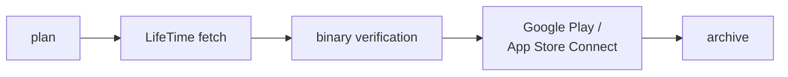

# Troubleshooting

Every error and warning the store release pipeline itself can print, what it means, and what to do. Messages are quoted exactly as in the code; `<...>` marks a value filled in at run time.

For how a release works and what the inputs do, see [RELEASING_GUIDE.md](RELEASING_GUIDE.md).

## Contents

- [Finding the error](#finding-the-error)
- [Before you re-run](#before-you-re-run)
- [Plan](#plan)
- [LifeTime fetch](#lifetime-fetch)
- [Binary verification](#binary-verification)
- [Google Play](#google-play)
- [App Store Connect](#app-store-connect)
- [Archive](#archive)
- [Check connections](#check-connections)

## Finding the error

1. Open the failed run. Pipeline errors appear as red **annotations** at the top of the run page; warnings as yellow ones.
2. Click the red job, then the red step. The step name tells you the stage:

   | Failed step | Stage |
   |---|---|
   | `plan` job | [Plan](#plan) |
   | **Fetch binary from LifeTime** | [LifeTime fetch](#lifetime-fetch) or [Binary verification](#binary-verification) |
   | **Upload to Google Play** | [Google Play](#google-play) |
   | **Upload to App Store Connect** | [App Store Connect](#app-store-connect) |
   | **Create GitHub Release** / **Download … binary** | [Archive](#archive) |

3. From the terminal: `gh run view <run-id> --log-failed`.

How messages look:

- From `scripts/lifetime.py` (plan, fetch, verification): `::error::<message>` / `::warning::<message>` in the log, shown as annotations. Run locally, they print as `ERROR: <message>` / `WARNING: <message>`.
- From fastlane (store steps): errors raised by the pipeline print as `[!] <message>`; warnings appear in yellow in the log.
- Errors from Google Play or App Store Connect themselves are passed through by fastlane unchanged. Their exact wording is decided by Google / Apple and can change; the entries below that come from the stores are marked **(store message)**.

## Before you re-run

- **Fix the cause first.** Re-running with the same inputs and the same LifeTime state gives the same error.
- **Android and iOS are independent.** If one failed, the other may already be in its store. Check before re-running both; re-run only the failed one (**Re-run failed jobs**, or a new run with `platform=android` / `platform=ios`).
- **Failure after the store step?** If only `archive` failed, the store upload already happened. Don't start a new release: see [Archive](#archive).
- Re-run behaviour per store: [RELEASING_GUIDE.md → Re-run after a failure](RELEASING_GUIDE.md#re-run-after-a-failure).

---

## Plan

The `plan` job validates the inputs and `config/app.json`. Nothing has been downloaded or uploaded yet; fixing the input and starting a new run is always safe.

**`android_rollout must be a number greater than 0 and at most 100 (got '<value>')`**
- Meaning: `android_rollout` isn't a plain number in `(0, 100]`. Checked on every run, even `platform=ios`. Values like `10%`, `0`, `,5` or `150` fail.
- Fix: use digits and an optional dot decimal, e.g. `10`, `2.5`, `100`.

**`<app name> is not configured for <platform> (configured: [<platforms>])`**
- Meaning: the `platform` you chose isn't in `platforms` in `config/app.json`. The `(configured: …)` part appears only in the `plan` job; `fetch` prints the same message without it.
- Fix: choose a configured platform, or ask a maintainer whether `config/app.json` was changed by mistake.

**`app.json: <problem>; <problem>`** (from `plan` and `fetch`) and **`config/app.json: <problem>`** (from the **Validate** workflow on pull requests)
- Meaning: `config/app.json` is invalid. Possible problems:
  - `id must be lowercase letters, digits and dashes`
  - `name is required`
  - `the file must contain a JSON object`
  - `lifetimeAppId must be the LifeTime application key (a lowercase UUID)`
  - `environment is required`
  - `platforms must be a non-empty subset of ['android', 'ios']`
  - `androidPackage is required for android and must look like 'com.example.app'` / `iosBundleId is required for ios and must look like 'com.example.app'` (an Android package takes letters, digits and underscores, each segment starting with a letter; an iOS bundle ID takes letters, digits and hyphens)
- Fix: a maintainer corrects `config/app.json` through a pull request. Don't edit it to get a release through.

**`Cannot read <path>: <reason>`** / **`app.json is not valid JSON: <detail>`**
- Meaning: `config/app.json` is missing or isn't valid JSON (a trailing comma, a missing quote).
- Fix: a maintainer corrects the file through a pull request; `python3 scripts/lifetime.py check-config` checks it locally.

**`LIFETIME_HOST must be the LifeTime host name, e.g. lifetime.example.com`**
- Meaning: the `LIFETIME_HOST` variable isn't a host name (it is empty after the scheme, or contains spaces or a user name).
- Fix: a maintainer sets it to the LifeTime host only, e.g. `gh variable set LIFETIME_HOST --body "mycompany-lt.outsystemsenterprise.com"`.

**`config/app.json still has the template placeholder lifetimeAppId. Set it (and name, androidPackage, iosBundleId, environment) to your app: see docs/SETUP.md.`** (from `fetch` and `status`)
- Meaning: `lifetimeAppId` is still the template value `00000000-0000-0000-0000-000000000000`, so the repository hasn't been set up for an app yet. `fetch` and `status` stop before calling LifeTime. `plan` and `check-config` accept the placeholder, so **Validate** still passes.
- Fix: set every field of `config/app.json` to your app (the LifeTime application key, package / bundle ID, default environment) through a pull request. How to find the key: [SETUP.md → First-time setup](SETUP.md#first-time-setup).

---

## LifeTime fetch

Step **Fetch binary from LifeTime** (`scripts/lifetime.py fetch`). `<label>` below is `<app name> / <Android|iOS> in <environment>`, e.g. `My App / iOS in Production`.

Run **Actions → Check connections** to see, for every LifeTime environment, the deployed app version and whether each native build is configured / has a binary / has a changed configuration.

### Connection and credentials

**`LIFETIME_HOST and LIFETIME_API_TOKEN must be set`**
- Meaning: the `LIFETIME_HOST` repository variable or the `LIFETIME_API_TOKEN` secret is missing or empty for this run.
- Fix: a maintainer sets them ([SETUP.md](SETUP.md)). If the token is stored as an environment secret, it must exist in the environment the job ran in (`store-production` or `store-testing`).

**`Cannot reach LifeTime at <host>: <reason>. If LifeTime has an IP allowlist, use a self-hosted runner or allowlist the runner IPs.`**
- Meaning: no network connection to LifeTime (DNS failure, timeout, connection refused or dropped, TLS error). The most common cause is a LifeTime IP allowlist that blocks GitHub-hosted runners, whose IPs change.
- Fix: check `LIFETIME_HOST` is right (`mycompany-lt.outsystemsenterprise.com`, no path). If LifeTime has an allowlist, a maintainer either allowlists the runner IPs or moves the jobs to a self-hosted runner. Then re-run.

**`LifeTime GET <path> failed: HTTP <code> <detail>`**
- Meaning: LifeTime answered with an HTTP error. `<detail>` is the first 500 characters of LifeTime's response. Typical codes:
  - `401`: token invalid, expired or revoked.
  - `403`: the service account lacks permission on that environment or application.
  - `404`: environment or application key not found (e.g. `lifetimeAppId` in `config/app.json` is wrong).
  - `5xx`: LifeTime-side problem; retry later.
- Fix: for 401/403, a maintainer rotates the token or fixes the service account's permissions in LifeTime ([SETUP.md](SETUP.md), key rotation). Confirm with **Check connections**.

**`LifeTime GET <path> returned a non-JSON response (HTTP <code>): '<first 200 characters>'. Check that LIFETIME_HOST is the LifeTime host and LIFETIME_API_TOKEN is a LifeTime service account token.`**
- Meaning: something answered, but not the LifeTime API: typically an SSO login page, a proxy or firewall page, or a host that isn't LifeTime. The start of the response is shown to help tell which.
- Fix: a maintainer checks that `LIFETIME_HOST` is only the LifeTime host name (no path) and that `LIFETIME_API_TOKEN` is a LifeTime service account token ([SETUP.md](SETUP.md)). Confirm with **Check connections**.

**`Refusing redirect to non-HTTPS URL (<scheme>://...)`** / **`Refusing non-HTTPS download URL (<scheme>://<host>)`**
- Meaning: LifeTime (or a redirect) pointed to a plain-HTTP URL. The pipeline only downloads over HTTPS and stops instead.
- Fix: not fixable from the workflow. Report it to your OutSystems administrator (or OutSystems Support).

**`Binary download from <host> failed: HTTP <code>`** / **`Binary download from <host> failed: <reason>`**
- Meaning: LifeTime gave a download link, but downloading the file failed. Download links can expire; network errors are usually transient.
- Fix: re-run the failed job. If it keeps failing with the same host, check that host is reachable from the runner (allowlists).

### Environment and app

**`Environment '<name>' not found. Available: <names>`**
- Meaning: the `environment` input (or `environment` in `config/app.json`) doesn't match any LifeTime environment name. The list shows what LifeTime returned.
- Fix: `environment` is free text and must match a LifeTime environment name exactly. Re-run with a name from the list, or fix `environment` in `config/app.json` (through a pull request) if the default is wrong.

**`LifeTime app '<name>' is not a mobile app (Kind=<kind>)`**
- Meaning: `lifetimeAppId` in `config/app.json` points at a LifeTime application that isn't a mobile app.
- Fix: a maintainer corrects `lifetimeAppId` to your mobile app's application key.

**`'<name>' is not deployed in this environment`**
- Meaning: the app isn't deployed in the selected LifeTime environment.
- Fix: deploy it there through LifeTime, or choose the environment it's deployed in (usually `default` = the `environment` in `config/app.json`).

### Native build state

**`<label>: no <Android|iOS> build configured in LifeTime`**
- Meaning: LifeTime has no native build entry for that platform in this environment.
- Fix: configure the platform in LifeTime → Applications → <your app> → **Native Platforms** for this environment, generate the build, then re-run.

**`<label>: native platform not configured in LifeTime (Applications > <app name> > Native Platforms)`**
- Meaning: the native platform exists but isn't configured for this environment.
- Fix: configure it in **Native Platforms** (Android: Release / AAB; iOS: App Store with a valid distribution profile), generate the build, re-run.

**`<label>: native configuration changed since the last build; the binary may be outdated. Regenerate it in LifeTime if needed.`** (warning)
- Meaning: Native Platforms settings changed after the current binary was built. The run continues with the existing binary.
- Fix: if the change matters for this release (signing, plugins, identifiers), cancel, regenerate the build in LifeTime, wait for it to finish, and start again.

**`<label>: no binary available. Generate the build in LifeTime first and wait for it to finish.`**
- Meaning: no binary exists yet for this platform/environment, or the build is still running or failed.
- Fix: generate the native build in LifeTime and wait until it finishes successfully. **Check connections** shows `binary` once it's there.

**`<label>: the API returned no aab/apk (HTTP 204). LifeTime only serves builds attached to a tagged version, and the running version isn't tagged (e.g. a hotfix, or a build generated from Service Center). Deploy a tagged version to this environment through LifeTime, or tag the running version there.`**
(for iOS: `...returned no ipa (HTTP 204)...`)
- Meaning: LifeTime has a binary, but the API refuses to serve it because the running version isn't a tagged version.
- Fix: in LifeTime, tag the running version, or deploy a tagged version to this environment through LifeTime; let the native build finish; re-run.

**`<label>: LifeTime served an APK. Google Play requires an Android App Bundle (.aab) for new apps; set the build to AAB in LifeTime Native Platforms.`** (warning)
- Meaning: LifeTime returned an `.apk` instead of an `.aab`. The run continues, but APK verification needs `aapt2` (see below) and Google Play may refuse the APK.
- Fix: set the Android build format to **AAB** in Native Platforms, regenerate, re-run.

---

## Binary verification

Still in **Fetch binary from LifeTime**, after the download. Nothing has been sent to any store yet.

**`<label>: the downloaded file is not a valid app archive`**
- Meaning: the download isn't a ZIP-based file (AAB, APK and IPA are all ZIPs). Usually a truncated download or an error page served instead of the file.
- Fix: re-run. If it persists, regenerate the build in LifeTime.

**`<file> is not a valid <.aab|.apk|.ipa> file: <detail>`** / **`<file> is not a valid IPA (no Payload/*.app)`**
- Meaning: the archive opened but doesn't have the expected structure or content (e.g. no Android manifest, no `Payload/*.app` or `Info.plist` in an IPA, or an `Info.plist` / provisioning profile that can't be parsed).
- Fix: regenerate the build in LifeTime and re-run. If it keeps happening, report it to your OutSystems administrator (or OutSystems Support) with the run link. The rejected file is not kept: run artifacts are only uploaded after the fetch step succeeds.

**`Unsupported binary type: <file>`**
- Meaning: internal check; the file extension isn't `.aab`, `.apk` or `.ipa`. Shouldn't happen in the workflow.
- Fix: report it with the run link.

**`<label>: could not read the app identifier from <file>, so it cannot be verified against com.example.myapp`**
(for APKs, followed by ` (APK inspection needs aapt2 from the Android SDK)`)
- Meaning: the package / bundle ID couldn't be read from the binary. The pipeline refuses to upload a binary it can't verify. For APKs this happens when the runner has no `aapt2`.
- Fix: Android: set the build format to **AAB** in Native Platforms and regenerate (AABs are read without extra tools). iOS: regenerate the build; report if it persists.

**`<label>: binary identifier <found> does not match configured com.example.myapp`**
- Meaning: the binary is for a different app id, typically a test/enterprise build from a non-production environment with a different identifier.
- Fix: release from the environment that builds with the store identifier (normally `default` = the `environment` in `config/app.json`). Never change `config/app.json` to make this pass.

**`<label>: IPA is signed with a '<enterprise|ad-hoc|development|unsigned>' profile (<profile name>). App Store Connect only accepts App Store distribution builds; set the build type to 'App Store' in LifeTime Native Platforms for this environment.`**
- Meaning: the IPA's embedded provisioning profile isn't an App Store distribution profile (or there is none). A profile that allows debugging (`get-task-allow`) is always `development`, even if it lists no devices.
- Fix: in Native Platforms for this environment, set iOS build type **App Store** with a valid App Store distribution profile, regenerate, re-run.

**`<label>: the IPA's provisioning profile (<profile name>) expired on <date> UTC, so App Store Connect would reject it. Renew the distribution profile, update it in LifeTime Native Platforms and regenerate the build.`**
- Meaning: the IPA is signed with an App Store profile whose expiry date has passed. Apple refuses builds signed with an expired profile, so the pipeline stops before contacting it.
- Fix: renew the App Store distribution profile (and its certificate if that expired too) in the Apple Developer portal, upload it in LifeTime → Native Platforms for this environment, regenerate the build, re-run.

**`<label>: unexpected version '<value>' in the binary`** / **`<label>: unexpected build '<value>' in the binary`**
- Meaning: the version name or version code / build number read from the binary is empty or contains characters other than letters, digits, `.`, `_`, `-` (max 64 characters). These values are used in file names and tags, so the pipeline refuses them.
- Fix: check the app version / build number settings in LifeTime / the native build configuration and regenerate.

**`Refusing multi-line value for output '<name>'`**
- Meaning: a value read from LifeTime or the binary contained a line break. The pipeline refuses it to protect the workflow.
- Fix: report it with the run link; it points to unexpected data in LifeTime or the binary.

---

## Google Play

Step **Upload to Google Play** (`fastlane android upload`). Messages with `[!]` stop the job.

**`[!] RELEASE_FILE environment variable is not set`** / **`[!] Release file not found at <path>`**
- Meaning: the fastlane step didn't receive the binary from the fetch step. Shouldn't happen when the fetch step succeeded.
- Fix: re-run the job; if it repeats, report it to a maintainer with the run link.

**`Release notes are <n> characters; Google Play keeps only the first 500.`** (warning)
- Meaning: `release_notes` is longer than Google Play's 500-character limit. The pipeline sends only the first 500 characters; the run continues.
- Fix: none needed if the cut is acceptable. Otherwise edit the notes in Play Console, or shorten them next time.

**`[!] ANDROID_ROLLOUT must be greater than 0 and at most 100 (got <value>)`**
- Meaning: the rollout reached fastlane outside `(0, 100]`. The `plan` job normally catches this first.
- Fix: use a number from the [Plan](#plan) rule and start a new run.

**`[!] ANDROID_RELEASE_STATUS must be 'completed' or 'draft' (got '<value>')`**
- Meaning: the lane was given another release status. The workflow form only offers these two, so this only happens when the lane is run by hand or the workflow was edited.
- Fix: use `completed` or `draft`. A staged rollout is `completed` with a rollout below `100`.

**`Staged rollouts are not available on the internal testing track; releasing to all internal testers.`** (warning)
- Meaning: `android_rollout` was below `100` with `android_track=internal`. The internal track has no staged rollouts, so the build goes to every internal tester.
- Fix: none needed.

**`A draft release has no rollout; set the percentage when you publish it in Play Console.`** (warning)
- Meaning: `android_release_status=draft` with `android_rollout` below `100`. The draft is created without a rollout.
- Fix: choose the percentage in Play Console when you publish the draft.

**`Version code <n> is already uploaded and is on '<source track>'. Promoting it to '<track>'...`** (warning) followed by **`Promoted version code <n> from '<source track>' to '<track>'.`**
- Meaning: not an error. Google Play already had this version code on `<source track>` (the first of internal, alpha, beta, production that holds it), so the pipeline promoted it to `<track>` instead of uploading, with the chosen status, rollout and release notes. See [RELEASING_GUIDE.md → Promote a build already on Google Play](RELEASING_GUIDE.md#promote-a-build-already-on-google-play).
- If the promotion itself fails, the job fails with Google Play's error **(store message)**. Fix: read the message; promote it in Play Console, or ship a build with a higher version code.

**`Version code <n> is already on '<track>'. Setting its rollout to <rollout>%...`** (warning) followed by **`Rollout of version code <n> on '<track>' set to <rollout>%.`**
- Meaning: not an error. The build is already on the track you chose, so the pipeline changed the rollout of that release (and its release notes, if given) instead. `100` completes a staged rollout.

**`[!] Version code <n> on '<track>' is already fully released (or halted); the pipeline does not change it. To ship new code, generate a build with a higher version code in LifeTime.`**
- Meaning: the build is already on `<track>` and that release is completed (or halted in Play Console), so there is no rollout the pipeline can change. Resume a halted release in Play Console.
- Fix: nothing to do for this build. For a new release, generate a build with a higher version code in LifeTime.

**`[!] Version code <n> is already on the '<track>' track; there is no draft to create. Manage it in Play Console.`**
- Meaning: you asked for a `draft` on a track that already has this build.
- Fix: manage the release in Play Console, or start a new run with `android_release_status=completed`.

**`[!] Google Play already has version code <n>, but it is not on the internal, alpha, beta or production track (it was superseded, or only exists in App bundle explorer).`**
`Either add it to '<track>' in Play Console (Test and release -> the track -> Create release -> 'Add from library'), or generate a build with a higher version code in LifeTime.`
- Meaning: Google Play knows this version code, but no track currently releases it, so there is nothing to promote from.
- Fix: do what the message says in Play Console, or generate a new build in LifeTime with a higher version code.

**`... package name must be registered to your verified developer identity ...`** **(store message, wording may vary)**
- Meaning: Google Play's Android developer verification doesn't yet know the key that signs this app.
- Fix: Play Console → **Android developer verification → Manage package keys** → **Add key**, using the SHA-256 fingerprint from the error. Then re-run.

**Permission / authentication errors** **(store message)**, e.g. the caller doesn't have permission, or the JSON key is invalid
- Meaning: the Google Play service account key is wrong, revoked, or lacks permission on the app.
- Fix: run **Check connections**; a maintainer checks the key and the service account's app permissions ([SETUP.md](SETUP.md), Google Play permissions).

**Other Google Play rejections** **(store message)**, e.g. track or rollout not allowed, release notes locale not in the store listing, policy issues
- Meaning: Google Play refused the release. On a dry run this is what `validate_only` is there to catch.
- Fix: read the message; it usually names the field. Check the track, `android_rollout`, `android_release_status` and `RELEASE_NOTES_LANGUAGES` against what Play Console shows for the app.

---

## App Store Connect

Step **Upload to App Store Connect** (`fastlane ios upload`). On a dry run this step does nothing but print `Dry run: IPA validated by the fetch step; App Store Connect is not contacted.`; App Store Connect errors only show up on real runs or in **Check connections**.

**`[!] RELEASE_FILE environment variable is not set`** / **`[!] Release file not found at <path>`**
- Same as for [Google Play](#google-play).

**`[!] IOS_TARGET must be 'testflight' or 'app-store-review' (got '<value>')`**
- Meaning: the lane was given another target. The workflow form only offers these two, so this only happens when the lane is run by hand or the workflow was edited.
- Fix: use `testflight` or `app-store-review`.

**`[!] No app with bundle ID <bundle id> in App Store Connect (or the API key cannot see it)`**
- Meaning: the API key works, but no app with that bundle ID is visible to it (wrong team or key).
- Fix: run **Check connections**; a maintainer checks the key's team and role ([SETUP.md](SETUP.md)). The App Store Connect app record must already exist: the pipeline doesn't create it ([SETUP.md → Store prerequisites](SETUP.md#store-prerequisites)).

**`Build <n> of version <v> is already in App Store Connect. Not uploading it again.`** (warning)
- Meaning: not an error. App Store Connect already has an upload of this exact version and build that is processing or processed (the lookup asks App Store Connect for uploads in state `PROCESSING` or `COMPLETE`), so the existing build is used. With `release_notes` or `app-store-review`, the job waits for processing, sets the notes as **What to Test** (tester groups are not changed), then continues to the submission if requested. An earlier upload that **failed** doesn't count: the build is uploaded again.

**`Could not check App Store Connect for an earlier upload of <v> (<n>): <reason>. Uploading.`** (warning)
- Meaning: the pre-upload check failed (e.g. a temporary API error). The job uploads anyway.
- Fix: usually none. If the upload then fails because the build already exists, see below.

**Duplicate build / version errors** **(store message)**, e.g. the bundle version has already been used, or the version is closed for new builds
- Meaning: App Store Connect already has this build number for the version (and the pre-upload check couldn't see it, e.g. because the lookup failed), or the app version is already released / no longer accepts builds.
- Fix: generate a new build in LifeTime with a higher build number (and a higher app version if the version is already live).

**Authentication errors** **(store message)**, e.g. invalid or expired token, 401
- Meaning: `ASC_KEY_ID`, `ASC_ISSUER_ID` or `ASC_KEY_P8` is wrong, revoked, or the key lacks the App Manager role.
- Fix: run **Check connections**; a maintainer checks / rotates the key ([SETUP.md](SETUP.md)).

**Submission errors for `app-store-review`** **(store message)**, e.g. another version is already in review, missing "What's New" or other required metadata, export compliance
- Meaning: the upload worked but App Store Connect refused the submission. The pipeline submits with the build, the release notes (as "What's New" in the languages the App Store version already has) and the export-compliance answer from `IOS_USES_NON_EXEMPT_ENCRYPTION` (default `false`, used only when the build's `Info.plist` doesn't declare `ITSAppUsesNonExemptEncryption`). It doesn't fill any other required App Store Connect information.
- Fix: fix the issue in App Store Connect (remove the other submission, complete the missing information, or pass `release_notes`). Then re-run the failed job: since the build is already in App Store Connect, the upload is skipped and only the submission is retried.

**`Could not read the App Store version's languages (<reason>); using the app's primary language.`** (warning)
- Meaning: the release notes go to the App Store version's languages, but reading them failed, so only the app's primary language gets "What's New".
- Fix: if the submission then fails for missing "What's New" in another language, add it in App Store Connect and re-run the failed job.

**Builds stuck at "Missing Compliance" in TestFlight**
- Meaning: the build's `Info.plist` doesn't declare `ITSAppUsesNonExemptEncryption`, and no export-compliance answer was recorded for it.
- Fix: answer it in App Store Connect for this build. For the next builds, declare the key in `Info.plist` through MABS extensibility, or set the `IOS_USES_NON_EXEMPT_ENCRYPTION` variable ([SETUP.md](SETUP.md#1-secrets-and-variables)).

**Timeout while waiting for processing**
- Meaning: with `app-store-review`, or with release notes, the job waits for Apple to process the build. The iOS job stops after 90 minutes.
- Fix: check the build in App Store Connect. Once processed, re-run the failed job; the upload is skipped because the build is already there.

---

## Archive

Job **Archive release**. When this job fails, the store uploads have **already happened**. Don't start a new release.

- **`This repository is public: archiving would publish the app binaries to everyone. Use a private repository, or run with archive_release unticked.`**: the archive job refuses to run in a public repository. Make the repository private (recommended: it holds your store credentials), or untick `archive_release`.
- **Waiting for approval, or "branch is not allowed to deploy"**: the job runs in the `store-testing` environment, so that environment's rules apply (required reviewers, deployment branches). Approve it, or run releases from an allowed branch ([SETUP.md](SETUP.md#4-configure-the-store-production-environment)).

- **Download Android/iOS binary fails**: the workflow artifact from the platform job couldn't be downloaded (e.g. expired after 30 days, or deleted; in a public repository no artifact is created at all). Re-run only the `archive` job from the run page (**Re-run jobs** on that job) while the artifacts are still listed on the run.
- **Create GitHub Release fails** (message from the `gh` CLI): common causes are a release with the same tag already existing (two runs for the same version in the same UTC minute) or missing `contents: write` permission. Re-run the `archive` job; if the tag already exists, check **Releases**: it may be a duplicate you don't need.
- If the artifacts are gone, the binaries can't be archived from that run. Record the version/build somewhere permanent; the store still has them.

See [VERSION_ARCHIVING.md](VERSION_ARCHIVING.md).

---

## Check connections

Workflow **Check connections** (`check-credentials.yml`). Read-only; it never uploads.

| Job | Fails with | Meaning / fix |
|---|---|---|
| LifeTime build status | Any [LifeTime connection](#connection-and-credentials) error | Same meaning and fix as in the release |
| LifeTime build status | A row with text in the **Error** column of the table | That environment couldn't be read (e.g. a `LifeTime GET ... failed: HTTP <code>` error, or `LifeTime app '<name>' is not a mobile app ...`). The job still succeeds and the rest of the table is valid. A row showing `not deployed` is not an error: the app just isn't in that environment |
| Google Play access / App Store Connect access | Shown as **skipped** | `config/app.json` doesn't list that platform in `platforms`. Nothing to fix |
| Read app config | `app.json: <problem>` | `config/app.json` is invalid: see [Plan](#plan) |
| Google Play access | Google Play error **(store message)** | Service account key or app permissions problem. Success prints `Google Play access OK for com.example.myapp; production version codes: <codes>` |
| App Store Connect access | `[!] App not found with bundle ID com.example.myapp` | The API key works but can't see an app with that bundle ID (wrong team / key). Success prints `App Store Connect access OK for <app name> (<bundle id>)` |
| App Store Connect access | Authentication error **(store message)** | Wrong or revoked API key |

Reading the LifeTime table: `configured` = Native Platforms configured; `binary` = a binary is available; `config changed` = settings changed since the last build; `not built` = neither configured nor built. The table doesn't show whether the running version is tagged, so a green row can still give [HTTP 204](#lifetime-fetch) on release.
