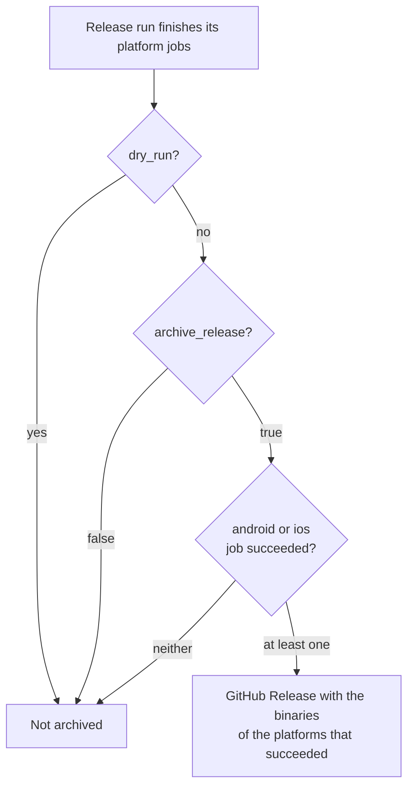

# Release archiving

After a real (non-dry-run) release, the **Archive release** job stores the binaries that were sent to the stores as a **GitHub Release** in this repository. Workflow artifacts (created only in a private repository) expire after 30 days; GitHub Releases stay until someone deletes them.

## When a release is archived



- Only platforms whose job **succeeded** are archived. If Android succeeded and iOS failed, the release contains only the Android binary.
- "Succeeded" means the store accepted the upload, promotion or submission. It doesn't mean the version is live: an Android `draft` release or an iOS version waiting for review is archived too.
- The job is defined in [`release.yml`](../.github/workflows/release.yml) (`archive`).

## What is saved

| Item | Value |
|---|---|
| Tag | `my-app-v<version>-<yyyymmddHHMM>` (UTC time the archive job ran), e.g. `my-app-v3.2.1-202501011200` |
| Tag target | The commit the workflow ran from (`--target $GITHUB_SHA`), i.e. the pipeline code used, not the app source |
| Title | `my-app v<version>` |
| Assets | `my-app-<version>-<build>.aab` and/or `my-app-<version>-<build>.ipa` (`.apk` if LifeTime served an APK) |
| Notes | "Uploaded to stores on" + the UTC time the archive job ran; **Android version / build** and **iOS version / build** for each archived platform; the `release_notes` text under **What's New**, if any; the **SHA-256** of every asset |
| Latest | Created with `--latest=false`, so it never becomes the repository's "Latest" release |

Version and build come from the binary itself, not from LifeTime (the version falls back to LifeTime's `VersionNumber` only if the binary has none). `<version>` in the tag and title is the Android version when Android was archived, otherwise the iOS version. If the two platforms have different versions, only one appears in the tag; the notes list both.

Binaries are kept as release assets rather than committed to git: each is tens to hundreds of MB, and committing them would grow every clone with every release.

## Retrieve a past release

```bash
# List releases (newest first)
gh release list

# See the notes, including the SHA-256 checksums
gh release view my-app-v3.2.1-202501011200

# Download all assets, or only the IPA
gh release download my-app-v3.2.1-202501011200 --dir ./build-copy
gh release download my-app-v3.2.1-202501011200 --pattern "*.ipa" --dir ./build-copy

# Compute checksums and compare with the SHA-256 block in the notes
shasum -a 256 ./build-copy/*     # macOS
sha256sum ./build-copy/*         # Linux
```

Or use **Releases** on the repository page. To inspect a downloaded binary (identifier, version, iOS signing):

```bash
python3 scripts/lifetime.py inspect ./build-copy/my-app-3.2.1-<build>.ipa
```

## What it is (and isn't)

- **It is an audit trail**: which binary went to which store, from which pipeline commit, and when.
- **It helps crash triage**: match a store crash report to the exact build, using version and build number.
- **It is not a rollback mechanism.** Google Play and App Store Connect don't accept a version code / build number that isn't higher than what they already have, so an archived binary can't simply be uploaded again to replace a newer one. Rolling back means a new, higher-numbered build through LifeTime.
- **It is not tamper-proof.** Assets inherit the repository's access. Anyone with write access can edit or delete a release, its assets and its notes. The SHA-256 in the notes detects corruption or an accidental mix-up of files; it doesn't protect against someone who can edit the release, because they can edit the notes too.
- **It doesn't store secrets.** The binaries are already signed by MABS; no signing keys or store credentials are put in releases.

## Re-runs and duplicates

Each run (or re-run) that reaches the archive job creates a new release with its own timestamp in the tag, so re-running a release can produce more than one release for the same version. Check **Releases** after a re-run. If the archive job failed, see [TROUBLESHOOTING.md → Archive](TROUBLESHOOTING.md#archive).
